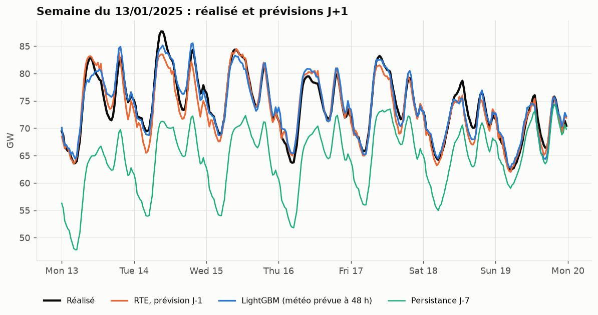
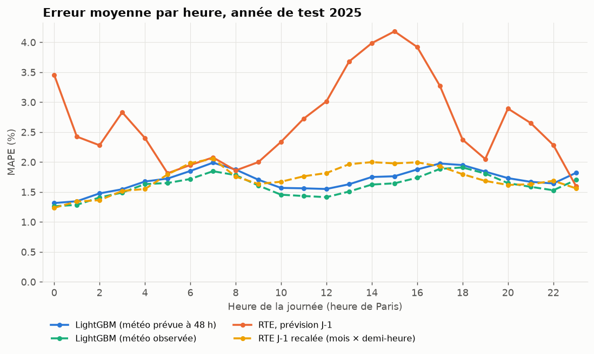
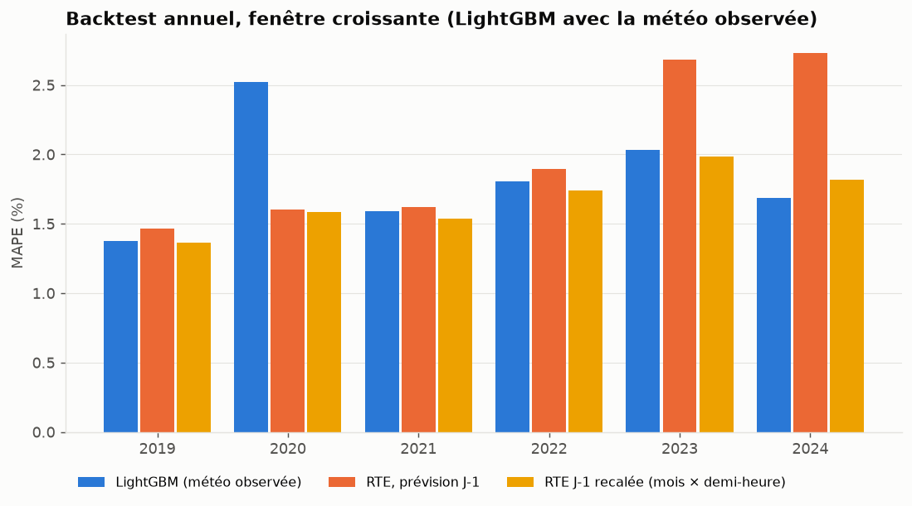
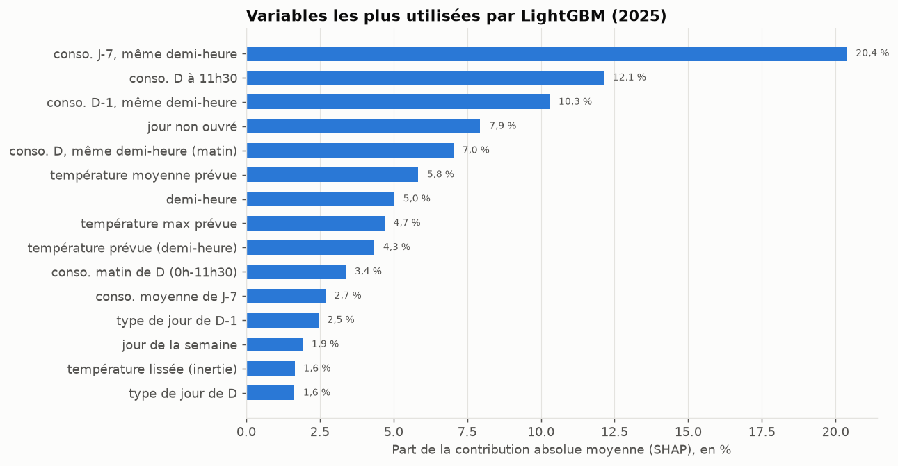
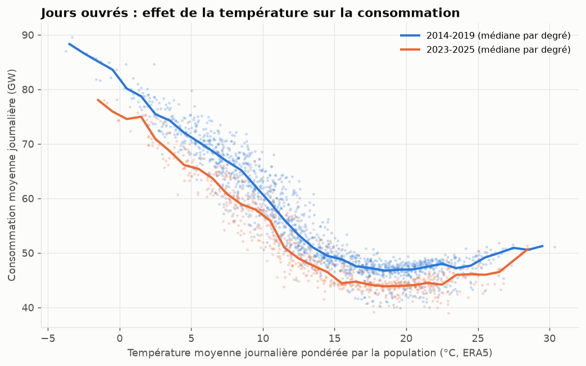

# eco2mix-forecast

Prévoir chaque jour à midi la consommation électrique française du lendemain, demi-heure par demi-heure, avec des données ouvertes, puis comparer le résultat à la prévision J-1 que RTE publie dans éCO2mix.

Code : https://github.com/pinpin-http/eco2mix-forecast

## En bref

Sur 2025, une année que le modèle n'a jamais vue pendant sa mise au point, LightGBM se trompe en moyenne de 1,70 % (MAPE) en n'utilisant que des informations disponibles à midi la veille, météo comprise. La colonne `prevision_j1` de RTE, comparée au même réalisé définitif, fait 2,67 %.

Ce n'est pas pour autant une victoire sur RTE. La plus grande part de l'écart vient d'un décalage systématique : en 2025, la prévision de RTE est en moyenne 973 MW sous les données définitives. Si on lui retire l'écart moyen qu'elle avait en 2024, mois par mois et demi-heure par demi-heure, elle descend à 1,72 % de MAPE et passe devant le modèle en RMSE (1 164 MW contre 1 234 MW). Les deux sont donc au même niveau, avec un avantage à RTE l'hiver et au modèle l'été.



## La question

Le jour D à midi, que vaudra la consommation de la France métropolitaine sur chacune des 48 demi-heures de D+1 ? RTE fait cet exercice tous les jours, c'est la « prévision J-1 » d'éCO2mix. Je voulais voir où l'on arrive avec des données publiques et un modèle courant, en s'interdisant tout ce qui ne serait pas connu à midi la veille, et mesurer l'écart avec RTE sans arranger les chiffres.

## Données

`make data` télécharge tout et le met en cache dans `data/`, qui n'est pas versionné. Aucune clé d'API n'est nécessaire.

| Source | Ce qu'on en tire | Point d'accès | Licence |
|---|---|---|---|
| RTE, éCO2mix national consolidé et définitif (plateforme ODRE) | consommation réalisée au pas de 30 min et prévision J-1 de RTE, 2012-2025 | `https://odre.opendatasoft.com/api/explore/v2.1/catalog/datasets/eco2mix-national-cons-def/exports/csv` | Licence Ouverte v2.0 (Etalab) |
| RTE, éCO2mix régional consolidé et définitif (ODRE) | consommation de la Nouvelle-Aquitaine (code INSEE 75), 2013-2025 | `https://odre.opendatasoft.com/api/explore/v2.1/catalog/datasets/eco2mix-regional-cons-def/exports/csv` | Licence Ouverte v2.0 (Etalab) |
| Open-Meteo, Historical Weather API, modèle `era5` | température horaire à 2 m, 2013-2025 | `https://archive-api.open-meteo.com/v1/archive` | données Open-Meteo sous CC BY 4.0 ; ERA5 : Copernicus Climate Change Service |
| Open-Meteo, Previous Runs API, modèle `ecmwf_ifs025` | température prévue 24 h (`previous_day1`) et 48 h (`previous_day2`) avant l'heure cible, depuis le 4 février 2024 | `https://previous-runs-api.open-meteo.com/v1/forecast` | données Open-Meteo sous CC BY 4.0 ; prévisions ECMWF (données ouvertes, CC BY 4.0) |
| API Découpage administratif (geo.api.gouv.fr) | population légale INSEE des communes, sommée par département et par région, pour pondérer les villes | `https://geo.api.gouv.fr/communes` | Licence Ouverte (données INSEE) |
| Ministère de l'Éducation nationale, calendrier scolaire | vacances scolaires des zones A, B et C | `https://data.education.gouv.fr/api/explore/v2.1/catalog/datasets/fr-en-calendrier-scolaire/exports/json` | Licence Ouverte v2.0 (Etalab) |

Les jeux éCO2mix sont produits par RTE. L'API gratuite d'Open-Meteo est réservée aux usages non commerciaux, ce qui est le cas ici. Les requêtes portent un User-Agent générique (`eco2mix-forecast/0.1 (+https://github.com/pinpin-http/eco2mix-forecast)`) et le script se bride pour rester sous les quotas publiés d'Open-Meteo.

### Température nationale

Une ville par région métropolitaine (le chef-lieu ; la Corse est exclue, elle n'est pas sur le réseau de RTE), pondérée par la population de sa région : Paris pèse 18,9 %, Lyon 12,5 %, Bordeaux et Toulouse 9,3 % chacune, Lille 9,1 %, Strasbourg 8,5 %, Marseille 7,9 %, Nantes 5,9 %, Rennes 5,2 %, Rouen 5,1 %, Dijon 4,3 %, Orléans 3,9 %. Pour la Nouvelle-Aquitaine, trois villes : Bordeaux (Gironde, Dordogne, Landes, Lot-et-Garonne, Pyrénées-Atlantiques, 58,2 %), Poitiers (Vienne, Deux-Sèvres, Charente, Charente-Maritime, 29,9 %) et Limoges (Haute-Vienne, Corrèze, Creuse, 11,9 %).

### Pas de temps

La consommation est publiée toutes les 30 minutes, la prévision de RTE tous les quarts d'heure ; on garde les instants :00 et :30. Tout est ramené en heure de Paris, dans une matrice jours × 48 demi-heures. Le dimanche du passage à l'heure d'été n'a que 46 demi-heures, donc 02:00 et 02:30 sont interpolés. Celui du retour à l'heure d'hiver en a 50 : les deux passages par 02:00 et 02:30 sont moyennés (dans les données définitives, le premier manque de toute façon). Le réalisé et la prévision de RTE subissent exactement le même traitement.

## Le cadre J+1

On se place le jour D à 12:00, heure de Paris, et on prévoit les 48 demi-heures du jour civil D+1. Le modèle a droit à :

- la consommation jusqu'au créneau de 11:30 du jour D inclus (éCO2mix publie le réalisé en quasi temps réel) ;
- les températures observées jusqu'à la même heure ;
- le calendrier, connu d'avance ;
- une prévision de température pour D+1.

Aucune variable du jour cible ne lit une donnée postérieure à la coupure, et des tests le vérifient : on remplace par du bruit tout ce qui suit D 12:00 (consommation et températures observées), en partant même de la série brute en UTC autour d'un changement d'heure, et les variables de D+1 doivent rester identiques au bit près.

### La météo du jour cible

C'est le point faible du projet. L'archive de prévisions utilisée (Previous Runs API d'Open-Meteo, ouverte et sans inscription) ne commence qu'en février 2024 pour ECMWF IFS, et en 2021 pour GFS. Il existe des archives plus anciennes (TIGGE chez ECMWF, par exemple), mais elles demandent une inscription et un autre outillage. Le modèle est donc entraîné avec la température observée (réanalyse ERA5) à la place de la prévision, et le backtest 2019-2024 utilise lui aussi l'observé : ses chiffres sont optimistes, ils supposent une météo parfaitement prévue.

Pour 2025, en revanche, on a les vraies prévisions archivées d'ECMWF IFS. Le modèle entraîné sur l'observé 2013-2024 est appliqué avec trois sources de température pour D+1 :

| Variante | Source de la température de D+1 | Statut |
|---|---|---|
| `lightgbm_fc_d2` | prévision émise 48 h avant chaque demi-heure cible (`previous_day2`) | strictement disponible à midi la veille ; c'est le chiffre de référence |
| `lightgbm_fc_d1` | prévision émise 24 h avant (`previous_day1`) | un peu optimiste : pour une partie des demi-heures de D+1, elle vient d'un run publié après midi la veille |
| `lightgbm_obs` | température observée (ERA5) | borne haute, météo parfaite |

L'écart moyen entre chaque prévision et ERA5, demi-heure par demi-heure, est estimé sur février-décembre 2024 puis retiré en 2025 ; aucune donnée de 2025 n'entre dans cette correction.

## Méthode

Une ligne par jour cible et par demi-heure, avec quatre familles de variables :

- le calendrier du jour cible : demi-heure, heure, jour de la semaine, jour de l'année, mois, férié (et lequel), pont, jour non ouvré, période du 24 décembre au 1er janvier, nombre de zones scolaires en vacances, jour de changement d'heure, heure d'été ;
- le type de jour de D, D-1 et J-7 (lundi, mardi-jeudi, vendredi, samedi, dimanche ou férié), pour que le modèle sache lire les retards ;
- la consommation connue à la coupure : même demi-heure la veille (pour les créneaux du matin seulement), valeur de D à 11:30, moyenne de la matinée de D et de celle de D-1, même demi-heure et moyenne de D-1, même demi-heure et moyenne de J-7, moyenne des six derniers jours complets, rapport entre la matinée de D et celle de D-1 ;
- la température : à la demi-heure cible, moyenne, minimum et maximum de D+1, moyenne de D-1, matinée de D, température lissée (moyenne exponentielle des journées jusqu'à D-1, demi-vie de 2 jours, pour l'inertie des bâtiments), écart entre D+1 et D-1.

Trois modèles sont comparés. La persistance J-7 reprend la même demi-heure une semaine plus tôt. La moyenne saisonnière fait la moyenne de l'entraînement par semaine ISO, type de jour et demi-heure. LightGBM utilise 1 500 arbres, un taux d'apprentissage de 0,03, 63 feuilles, 80 % des lignes et des variables tirées à chaque arbre, et 2 threads au plus. Deux cibles ont été essayées sur le backtest : la consommation en MW, ou la consommation rapportée à la moyenne des six derniers jours. La première gagne (1,84 % de MAPE contre 1,95 %) et sert pour le test, choisie sans regarder 2025. Le taux d'apprentissage, l'ajout de la variable « même demi-heure la veille » et la perte quadratique plutôt qu'absolue ont été décidés sur le seul pli 2019.

Le backtest avance une année à la fois, de 2019 à 2024, avec une fenêtre croissante : pour prévoir l'année Y, on entraîne sur 2013 à Y-1. Le test final prévoit 2025 après un entraînement sur 2013-2024. Dans chaque comparaison, tous les modèles sont jugés sur exactement les mêmes demi-heures.

Les métriques sont le MAPE (erreur absolue moyenne, en pourcentage du réalisé), la RMSE et la MAE en MW, et le biais moyen (prévision moins réalisé, donc positif quand on surestime). Elles sont calculées sur l'année, par saison météorologique et par heure.

### La prévision de RTE

C'est la colonne `prevision_j1` d'éCO2mix, « prévision, réalisée la veille pour le lendemain », comparée au même réalisé définitif que le modèle. Mesurée ainsi, elle sous-estime la consommation tous les ans : de 0,2 à 0,9 % de 2012 à 2021, de 1,1 % en 2022, puis de 2,0 à 2,3 % de 2023 à 2025, avec un écart qui dépend de l'heure. Je ne sais pas dire s'il vient de la prévision elle-même ou d'une différence de périmètre entre ce que RTE prévoit et ce que contiennent les données définitives. Pour ne pas gagner sur un simple décalage, j'ajoute deux contrôles, qui ne sont pas des produits de RTE :

- `rte_j1_debiaisee` : la prévision de RTE moins son écart moyen de l'année précédente (une constante) ;
- `rte_j1_profil` : la prévision de RTE moins son écart moyen de l'année précédente, calculé par mois et par demi-heure.

Les deux n'utilisent que l'année Y-1 pour corriger l'année Y.

## Résultats

Tous les chiffres viennent de `make backtest` et sont recopiés depuis `docs/results/tables.md`.

### France, année de test 2025

| Modèle | MAPE (%) | RMSE (MW) | MAE (MW) | Biais (MW) |
|---|---|---|---|---|
| LightGBM (météo observée) | 1,61 | 1 139 | 842 | 285 |
| LightGBM (météo prévue à 24 h) | 1,68 | 1 219 | 883 | 317 |
| LightGBM (météo prévue à 48 h) | 1,70 | 1 234 | 893 | 319 |
| RTE J-1 recalée (mois × demi-heure) | 1,72 | 1 164 | 881 | 172 |
| RTE J-1 recalée (écart constant) | 2,13 | 1 352 | 1 061 | 173 |
| RTE, prévision J-1 | 2,67 | 1 656 | 1 324 | -973 |
| Persistance J-7 | 6,41 | 5 139 | 3 451 | -92 |
| Moyenne saisonnière | 6,63 | 4 317 | 3 366 | 2 315 |

La consommation moyenne de 2025 est de 50,7 GW, donc 1 % d'erreur représente environ 500 MW.

Le chiffre honnête est la ligne « météo prévue à 48 h » : 1,70 %. Passer de la météo parfaite à une vraie prévision coûte moins d'un dixième de point (1,61 % puis 1,70 %). Une fois recalée, l'erreur absolue moyenne de la température nationale prévue n'est que de 0,66 °C à 48 h et de 0,58 °C à 24 h, ce qui explique cette faible perte.

Face à la prévision brute de RTE, le modèle a une erreur journalière plus faible 73 % des jours de 2025. Face à RTE recalée par mois et demi-heure, c'est 55 % des jours, un quasi pile ou face, et RTE garde une RMSE plus basse : elle fait moins de grosses erreurs. Le modèle, lui, surestime un peu 2025 (biais de +319 MW), comme chacune des six années du backtest. La consommation moyenne est passée de 56,2 GW en 2013 à 50,7 GW en 2025, et j'y vois surtout l'effet d'un modèle d'arbres entraîné sur des années plus consommatrices, qui garde un niveau un peu trop haut.

### Par saison et par heure

MAPE (%) en 2025 :

| | LightGBM (météo prévue à 48 h) | LightGBM (météo observée) | RTE, prévision J-1 | RTE J-1 recalée (écart constant) | RTE J-1 recalée (mois × demi-heure) | Persistance J-7 |
|---|---|---|---|---|---|---|
| hiver | 2,29 | 2,14 | 2,14 | 2,01 | 1,99 | 8,81 |
| printemps | 1,76 | 1,57 | 3,29 | 2,10 | 1,63 | 7,95 |
| été | 1,22 | 1,18 | 2,56 | 2,26 | 1,62 | 4,07 |
| automne | 1,55 | 1,55 | 2,68 | 2,13 | 1,65 | 4,85 |

L'hiver est la saison la plus dure pour le modèle, et c'est la seule où même la prévision brute de RTE fait mieux que lui (2,14 % contre 2,29 %). L'été, c'est l'inverse : 1,22 % contre 1,62 % pour RTE recalée.



Par heure, l'erreur du modèle va de 1,3 % vers minuit à 2,0 % vers 7 h, au moment de la montée du matin. Celle de la prévision brute de RTE culmine à 4,2 % à 15 h, avec d'autres bosses vers minuit, 3 h et 20 h ; le recalage par demi-heure efface presque toutes ces bosses, ce qui va dans le sens d'un écart de définition plutôt que d'erreurs de prévision. Ces créneaux ressemblent aux heures de bascule des chauffe-eau pilotés par le signal heures creuses, mais je ne l'ai pas vérifié.

### Backtest 2019-2024

MAPE (%) par année. Attention, LightGBM utilise ici la température observée, ses chiffres sont donc flatteurs.

| | LightGBM, cible en MW | LightGBM, cible ratio | RTE, prévision J-1 | RTE J-1 recalée (écart constant) | RTE J-1 recalée (mois × demi-heure) | Persistance J-7 | Moyenne saisonnière |
|---|---|---|---|---|---|---|---|
| 2019 | 1,38 | 1,61 | 1,46 | 1,49 | 1,36 | 6,00 | 5,09 |
| 2020 | 2,52 | 2,50 | 1,60 | 1,60 | 1,59 | 6,01 | 8,60 |
| 2021 | 1,59 | 1,83 | 1,62 | 1,58 | 1,54 | 7,10 | 5,50 |
| 2022 | 1,80 | 1,94 | 1,90 | 1,76 | 1,74 | 6,50 | 7,11 |
| 2023 | 2,03 | 2,04 | 2,68 | 2,04 | 1,98 | 6,48 | 8,48 |
| 2024 | 1,69 | 1,81 | 2,73 | 1,95 | 1,82 | 6,05 | 7,90 |

Sur les six années réunies, LightGBM fait 1,84 %, RTE brute 2,00 %, RTE recalée 1,74 % (constante) et 1,67 % (mois × demi-heure). Même avec une météo parfaite, le modèle ne bat donc pas RTE recalée sur la durée. 2020 le montre bien : le confinement fait chuter la consommation, le modèle ne le voit qu'à travers ses retards et surestime de 921 MW en moyenne sur l'année (2,52 % contre 1,60 % pour RTE). Même chose, en moins fort, avec la sobriété de 2022-2023. Le score de 2019 est en plus légèrement flatteur, puisque les réglages ont été choisis sur ce pli.



### Ce qui pèse dans le modèle



D'après les contributions SHAP (calculées par LightGBM lui-même) sur 8 000 demi-heures de 2025, les variables de consommation passée font 58 % de l'explication, la température 19 % et le calendrier le reste. La plus utilisée est la consommation de la même demi-heure sept jours plus tôt (20 %), devant la dernière valeur connue à 11:30 (12 %).

La courbe en V attendue est bien là : la consommation monte vite sous 15 °C environ (chauffage électrique), reste à plat jusqu'à 22-23 °C, puis remonte doucement avec la climatisation. Toute la courbe de 2023-2025 est décalée vers le bas par rapport à 2014-2019.



### Nouvelle-Aquitaine

Même méthode, avec la consommation régionale et la température des trois villes (cible en MW reprise du backtest national). Le jeu régional ne contient pas de prévision de RTE, donc pas de comparaison possible ici. La consommation moyenne de la région en 2025 est de 4,7 GW.

| Modèle | MAPE (%) | RMSE (MW) | MAE (MW) | Biais (MW) |
|---|---|---|---|---|
| LightGBM (météo observée) | 2,64 | 160 | 124 | 33 |
| LightGBM (météo prévue à 24 h) | 2,78 | 172 | 131 | 33 |
| LightGBM (météo prévue à 48 h) | 2,83 | 175 | 134 | 33 |
| Moyenne saisonnière | 8,16 | 502 | 389 | 167 |
| Persistance J-7 | 8,89 | 656 | 447 | -11 |

L'erreur relative est plus forte qu'au niveau national (2,83 % contre 1,70 %), ce qui n'a rien d'étonnant : une région agrège moins de consommateurs, et trois villes représentent mal le climat d'un territoire qui va du Limousin au Pays basque. La prévision de température y est aussi moins bonne (0,95 °C d'erreur absolue moyenne à 48 h). Sur le backtest, le MAPE moyen est de 2,71 %.

## Limites

Le modèle apprend sur des températures observées et reçoit des prévisions en 2025. Les deux n'ont pas la même distribution d'erreur, et la correction de l'écart moyen n'en rattrape qu'une partie. Entraîner directement sur des prévisions archivées serait plus propre, mais l'archive ouverte ne remonte qu'à février 2024.

ERA5 est une réanalyse sur une grille d'environ 30 km, publiée avec quelques jours de retard. En exploitation, il faudrait des observations de stations pour la veille et la matinée du jour D. De la même façon, les retards de consommation viennent ici des données définitives, alors qu'à midi le jour D on n'aurait que les données temps réel, un peu différentes.

Une ville par région, c'est une approximation grossière du climat. Ni la nébulosité, ni le vent, ni le rayonnement ne sont utilisés, alors qu'ils jouent sur l'éclairage, le ressenti et le solaire en autoconsommation.

Le jeu de données dit seulement que la prévision J-1 de RTE est « réalisée la veille pour le lendemain », sans heure précise, et l'écart avec les données définitives reste inexpliqué ici. La comparaison avec RTE dépend beaucoup de ce point : contre la prévision brute le modèle gagne nettement, contre la prévision recalée il fait jeu égal.

Les ruptures (confinement de 2020, sobriété de 2022-2023) ne passent dans le modèle qu'à travers les retards, donc avec un temps de retard. Les fériés propres à l'Alsace-Moselle (Vendredi saint, 26 décembre), les grèves, les effacements de consommation et les grands événements ne sont pas représentés. Enfin, le modèle donne une valeur ponctuelle, sans intervalle de confiance.

## Relancer

Il faut [uv](https://docs.astral.sh/uv/) et `make`.

```bash
git clone https://github.com/pinpin-http/eco2mix-forecast
cd eco2mix-forecast
uv venv --python 3.12
uv sync --frozen
make data       # téléchargements (mis en cache dans data/) et tables de travail
make backtest   # backtest 2019-2024, test 2025, résultats dans docs/results/
make figures    # figures PNG dans docs/
make test       # tests, sans réseau
```

Le premier `make data` prend environ une heure : les températures ERA5 représentent près de 5 000 appels au sens du quota d'Open-Meteo, et le script se bride pour rester sous la limite horaire gratuite. Les relances suivantes réutilisent le cache. `make backtest` entraîne 20 modèles LightGBM (deux cibles sur six plis plus le test pour la France, une cible sur six plis plus le test pour la Nouvelle-Aquitaine). Il tourne sur 2 threads par défaut (`ECO2MIX_N_JOBS`, `OMP_NUM_THREADS`), et chaque pli terminé est gardé dans `data/processed/cache/` : après une coupure, la relance reprend où elle s'était arrêtée.

## Organisation du code

```
src/eco2mix_forecast/
  config.py        chemins, périodes, villes, points d'accès
  download.py      téléchargements et cache (ODRE, Open-Meteo, geo.api.gouv.fr, Éducation nationale)
  calendar_fr.py   fériés, ponts, vacances scolaires, changements d'heure
  dataset.py       lecture des fichiers bruts, températures pondérées, matrice jours × 48 demi-heures
  features.py      variables J+1 à la coupure de midi
  models.py        persistance J-7, moyenne saisonnière, LightGBM
  metrics.py       MAPE, RMSE, MAE, biais, par groupe
  backtest.py      plis annuels, test 2025, comparaison à RTE, export des résultats
  report.py        figures et tableaux Markdown
tests/             fixtures synthétiques, aucun téléchargement
docs/              figures et résultats chiffrés (CSV, JSON, Markdown)
```

## Licence

Code sous licence MIT (voir `LICENSE`). Les données gardent leurs licences respectives (voir le tableau des sources) : données éCO2mix © RTE, Licence Ouverte v2.0 ; données météo par [Open-Meteo.com](https://open-meteo.com/) sous [CC BY 4.0](https://creativecommons.org/licenses/by/4.0/), issues d'ERA5 (Copernicus Climate Change Service) et des prévisions ouvertes d'ECMWF, agrégées ici en moyennes pondérées.
